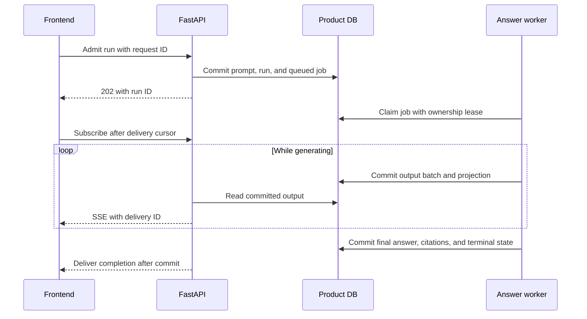

# Recoverable server-owned answer generation

Design coordinated: 2026-10-17. Status: implemented and verified locally;
not deployed or enabled in production. The current
[runtime guide](../product-chat-service/42-durable-answer-generation.md) documents setup and limits. Current status belongs to
[implementation tracking](../implementation-tracking.md#recoverable-answer-generation).

## User outcome and ownership

A browser disconnect detaches the viewer while the server continues generating and saving the
answer. Returning during execution restores partial output and continues listening. Returning
after completion loads the saved answer and citations immediately. Only explicit Stop cancels.

Backend Codex owns this repository, admission, jobs, execution, persistence, delivery contracts,
and offline/PostgreSQL tests. Frontend Opus owns the separate frontend repository, BFF forwarding,
reconnect/recovery UI, and browser tests. Coordination uses the Herdr skill in the shared workspace;
pane IDs are ephemeral and must be rediscovered. The frontend vulnerability patch is preserved.
Commit/push/deployment decisions remain separate from this contract agreement.

Legacy POST-stream behavior is described in the
[streaming contract](../product-chat-service/09-http-streaming-frontend-contract.md#client-disconnect-durability-gap).
Legacy stream generation is owned by `conversation_run_events`; its `GeneratorExit` path can
cancel an active run. Final assistant text is stored by `persist_completed_run`. Resume and
regeneration have separate execution paths and must receive the same new durability guarantees.

## Architecture

The independent worker consumes the existing LangGraph/ChatOpenAI output. It batches permitted
display text before committing, rather than writing every provider token or delaying all output
until generation completes. Initial time/size thresholds must be benchmarked. Full-document
buffering still preserves the required coverage disclaimer before the first visible delta.

Product DB remains the source of truth for transcript, run state, citations, output projection,
and delivery. A dedicated bounded output ledger stores delivery frames; do not expand the existing
metadata-only audit event union with `answer_delta` or transport completion events. Checkpoints
remain bounded execution state scoped by `run_id`, with the existing semantic HITL contract.

## Additive HTTP contract

Paths and fields below are implemented in the local backend. Existing sync and POST streaming
routes retain their contracts; legacy resume rejects durable runs to preserve execution ownership.

| Operation | Proposed route | Result |
| --- | --- | --- |
| Admit answer | `POST /conversations/{cid}/runs/async` | HTTP 202 admission receipt |
| Resume waiting run | `POST /conversations/{cid}/runs/{rid}/resume/async` | HTTP 202 receipt for same run |
| Regenerate answer | `POST /conversations/{cid}/messages/{mid}/replay/async` | HTTP 202 receipt for new run |
| Recover output | `GET /conversations/{cid}/runs/{rid}/output` | Atomic snapshot for any run status |
| Subscribe | `GET /conversations/{cid}/runs/{rid}/stream?after=N` | SSE listener; never executes or cancels |
| Stop | Existing `POST /conversations/{cid}/runs/{rid}/cancel` | Explicit cancellation, including queued work |

Normal admission uses the existing request body with required `client_request_id`. Receipt:
`{run_id, conversation_id, status, client_request_id}`. Save prompt, run, and queued job atomically;
resolve/pin model and reasoning at admission, preserving guest quota and authorization policies.

The same authenticated user, operation, key, and normalized request returns the same IDs and
current run status with HTTP 202, even if it has finished. A reused key with a different request or conversation returns
HTTP 409 `run_request_id_conflict`. Another request while a conversation has active work retains
HTTP 409 `conversation_run_already_active`. Concurrent retries must be arbitrated by the database.

Async resume body is `{client_request_id: UUID, answer: <existing semantic resume request>}`.
Async regeneration body is `{client_request_id: UUID, request: <existing ConversationReplayRequest>}`.
Both follow the same receipt/listener pattern. Resume continues the same run; regeneration creates
a new run and preserves success-only transcript pruning. Operation keys are scoped by authenticated
user and operation kind. A resume retry with the same key returns its receipt/current status even
after completion; a new key answering a stale interaction retains the existing conflict response.
Do not advertise durability while silently falling back to disconnect-cancelling legacy execution
for either operation. Transport reconnection must never mean regeneration or graph re-execution.

## Snapshot and cursor

Snapshot fields:

- `schema_version`: `1`.
- `run_id`, `conversation_id`, `client_request_id`.
- `status`: `queued`, `running`, `waiting_for_input`, `cancelling`, `completed`, `failed`, `cancelled`.
- `cursor`: last committed delivery ID reflected by the snapshot.
- `partial_reply`: current committed display text, not a completed assistant message.
- `reasoning_summaries`: separate permitted model-summary channel; never hidden reasoning.
- `activity_events`: display-safe envelopes `{id, event, data}`, with delivery IDs.
- `interaction`: nullable existing semantic interaction payload, preserving schema/type information.
- `result`: nullable existing canonical completed-run response, including evidence and artifacts.
- `error`: null or `{code: string, detail: string}` with safe allowlisted detail, never raw exceptions.

Read all snapshot fields at one consistent database boundary. Update the materialized projection
and cursor in the same transaction as the output batch. Snapshot replaces client state; the
following subscription appends only frames whose IDs are greater than `cursor`. Activity recovery
must use that boundary too; an unrelated read of the audit endpoint cannot guarantee it.

Delivery IDs are monotonic per run and independent of `answer_delta.sequence`. They do not reset
on HITL resume. `partial_reply` aggregates committed answer text across phases of the same logical
run; interaction prompts stay in `interaction` and provider-replayed prefixes must not be appended
twice. Clients deduplicate text delivery by ID. `run_interrupted` ends the current subscription
phase but preserves the waiting run. A waiting snapshot stops auto-reconnect until explicit resume;
a subscription to a waiting run delivers/repeats the interruption control state and closes.
The canonical completed result wins over partial
display state and must be committed before completion is observable.

`after` and `Last-Event-ID` are nonnegative integer delivery cursors; absence means zero. If both
are supplied they must match. Invalid/future cursors return HTTP 400 `invalid_stream_cursor`.
An expired cursor returns HTTP 410 `run_output_cursor_expired`; the client fetches a fresh snapshot
and reconnects. Bounded retention must preserve recoverable projection/final state after old frames
are removed. Retention duration, byte limits, and terminal replay retention require implementation
decisions and tests; partial content inherits conversation access/deletion rules.

An ended-run subscription replays remaining frames and delivers terminal state before closing.
If the terminal frame was already acknowledged, terminal state may be repeated as an idempotent
close signal; it must not duplicate transcript text. Clients recognize repeated terminal control
state even when ignoring already-applied text frames. Close without terminal state means reconnect.
Send SSE comment heartbeats approximately every 15 seconds. Multiple subscribers are allowed.

Durable-stream `run_failed` is terminal and carries
`{run_id, conversation_id, status: "failed", code, detail}`. `worker_lost` is a stable failure code;
unknown codes use safe generic frontend copy. Describe this as a route-specific `x-sse-events`
schema, without changing existing audit payloads or legacy stream schemas.

The remaining terminal/control payloads are fixed as follows:

- `run_completed`: the full existing `ConversationRunResponse`, identical to snapshot `result`,
  including canonical reply, citations, consulted sources, coverage, summaries, and artifacts.
  It is not merely a refetch signal. It is delivered only after the final database commit.
- `run_cancelled`: `{run_id, conversation_id, status: "cancelled", partial_reply_persisted: false}`.
  The last flag means no completed assistant message is added to the transcript. A bounded partial
  output projection may remain available for recovery/inspection; it is never treated as complete.
- `run_interrupted`: the existing full `ConversationRunInterruptedResponse` with run ID,
  conversation ID, waiting status, model, and semantic interaction. Keep this distinct from the
  smaller persisted audit-event payload of the same name.

All use SSE `id` for the delivery cursor, outside the JSON payload. Terminal/control schemas are
published for the new GET stream route and must be validated without assuming legacy audit shapes.

## Execution and failure boundaries

- Use persistent jobs, atomic claims, worker heartbeats, and ownership fencing. Provider calls
  run outside long database transactions. A stale owner must not commit output or finalization.
- Add `queued` to status contracts, active-run uniqueness, cancellation, and discovery. Run lists
  expose active async runs and their client request IDs. Existing completed/waiting detail can
  remain unchanged; the new snapshot supports every status.
- Cancellation and completion compete through a guarded database transition. Explicit Stop
  on queued work prevents execution. A subscriber closing its socket never changes run status.
- Detect lost workers and report `failed` with stable `worker_lost`; do not leave an endless
  running state or promise transparent continuation of an interrupted model request.
- Revalidate user/source authorization at execution and protect every output subscription/read.
  Do not persist provider credentials, sessions, raw exceptions, or unauthorized source text.
- Support waiting interactions without holding a worker lease. Resume must claim once,
  preserve the admitted answer model and graph compatibility checks, and reject stale answers.
- Preserve document-workspace access, quotas, cleanup, finalization, and attachment retention.
  Ensure new output/job rows participate in conversation and guest/account erasure paths.

## Frontend coordination and rollout

Opus found the BFF currently rebuilds paths without queries, drops `Last-Event-ID`, and streams
only the existing POST routes. It must allow the new GET stream, forward only a validated `after`
query there, forward `Last-Event-ID`, and preserve unbuffered response delivery. The parser already
reads SSE IDs, but the run loop does not reconnect or restore active output on cold load.

`MY_AGENTS_DURABLE_RUNS_ENABLED=false` keeps new chat/regeneration on legacy routes without
an extra worker service. Health `frontend_config.durable_runs.enabled` exposes this choice, while
`ready` reports worker availability. Enabled-but-unready admission returns a clear 503 without
silent fallback. Existing runs
retain execution-mode-based recovery and resume. Migration, independent worker readiness, and
backend integration verification remain deployment prerequisites.

Publish precise JSON schemas and stream `x-sse-events`. Opus generates frontend models from served
OpenAPI; a local backend server is sufficient for development generation. Mock review can proceed
earlier, but deployed contract verification
must precede enabling the frontend feature. Do not deploy either repository as part of contract
coordination. Reconnect copy must be distinct from Regenerate and Stop in both languages.

## Acceptance gates

Backend: concurrent duplicate admission; request-key mismatch; active-run exclusion; no job/prompt
orphan on transaction failure; claim fencing; snapshot/cursor race; ordered replay and deduplication;
expired/future cursors; explicit queued/running cancellation; lost-worker terminalization; two
subscribers; permission revocation/isolation; guest policy and erasure; workspace, HITL, resume,
and regeneration parity. Tests use deterministic providers and disposable databases by default.

Frontend: allowlisted BFF routing/query/header handling; cursor parsing/deduplication; atomic
snapshot plus remainder; disabled-flag legacy compatibility; enabled-but-unavailable errors without legacy fallback; reload mid-answer; automatic reconnect;
completed answer/citations on reopen; Stop remains terminal after reload; recovered unknown
interaction renders a cancel-capable fallback; two tabs; safe worker-loss messaging.

Joint: stop the browser subscription mid-generation and prove exactly one saved answer completes;
kill a worker and prove safe failure rather than duplicate provider execution; verify real BFF
delivery against the local backend before any hosted release. Separate new failures from the
frontend's reported pre-existing conversation-list failure and intermittent autoscroll failure.
