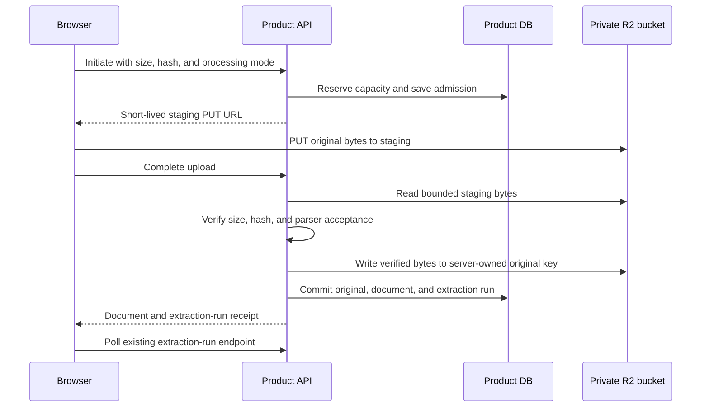

# Private document files and user preferences

This contract describes the active implementation of private originals, document processing, and
registered-user retrieval preferences. It does not establish deployment or live provider readiness.
Current status and acceptance evidence belong to
[implementation tracking](../implementation-tracking.md#active-private-document-files-and-preferences).

## Ownership and runtime

Product DB owns document permissions, metadata, original references, upload admissions, quota
reservations, processing provenance, active text, and search indices. A private R2 Standard bucket
holds immutable original bytes. R2 retention requires a persistent Product DB: PostgreSQL or
file-backed SQLite on a persistent local filesystem. An in-memory database cannot retain object ownership/cleanup records after a
restart and is rejected before private storage writes. Browser access uses short-lived,
permission-checked signed URLs;
R2 credentials remain in backend deployment secrets or an ignored local environment file.

The existing API process handles admission and verification. Extraction uses the existing
`in_process_thread` default; the API also drains a persistent object-cleanup outbox. No Cloudflare
Worker, separate answer worker, or additional Render service is required for this feature. The
existing external ingestion-worker mode remains an operator option. File SQLite connections enable
and verify WAL journaling with the existing five-second busy timeout; the app does not reduce
`FULL` synchronization. WAL lets polling read committed state during large writes, but still allows
only one writer and requires a local filesystem, not a network share. PostgreSQL is unchanged.
See [SQLite's WAL documentation](https://sqlite.org/wal.html). In-process extraction is not
crash-resumable execution: restart/stale-run recovery remains a separate operational limitation.

The temporary OpenAI document workspace keeps its separate consent, provider-file retention,
container expiry, and guest restrictions. R2 does not automatically preserve those attachments or
generated artifacts. This milestone stores knowledge-base upload originals only.

## Registered-user preferences

`GET /assistant/preferences` includes these fields alongside the existing model preferences:

| Field | Values | Default |
| --- | --- | --- |
| `document_retrieval_priority` | `always`, `automatic`, `on_request` | `automatic` |
| `document_ingestion_mode` | `standard`, `ai_assisted` | `standard` |

`PATCH /assistant/preferences` accepts one or more changed fields. Omitted fields are preserved;
an empty patch is rejected. Patch properties have no OpenAPI defaults: clients must serialize only
supplied fields (`exclude_unset` in Pydantic) rather than apply response defaults while building a
patch. Explicit `null` is rejected for both document preference fields; `assistant_model: null`
retains its existing meaning of resetting the model preference. Guests receive `automatic` and
`standard` and cannot customize them.
Changing the ingestion default does not reprocess existing documents. Upload and reprocess requests
may supply an `ingestion_mode` override; the selected value is pinned to that operation.

Retrieval preference is pinned at conversation-run admission and retained across resume:

- `always` requests authorized document search on each turn, unless the latest instruction says
  not to use saved documents or the selected scope excludes private knowledge.
- `automatic` preserves the existing source-selection decision.
- `on_request` searches when the current message explicitly requests documents or a specific KB
  scope is selected. Selecting all documents is not itself an explicit request. Bounded follow-up
  rules can continue a recent explicit document request; a new explicit source change takes priority.
  Plain English and Korean requests such as “use the document” or “문서 기반으로 알려줘” count as
  explicit document requests without requiring the word “saved.”

These preferences never grant access, expose ambient system knowledge, or override selected-KB
permissions. Continuing the decision to search is distinct from reconstructing the original
question and document target. Full follow-up query contextualization and adaptive neighboring-chunk
retrieval remain separate quality work; the settings do not claim to solve either.

## Frontend capability contract

`GET /health` exposes non-sensitive `frontend_config.documents`:

| Field | Meaning |
| --- | --- |
| `direct_uploads` | Product DB is persistent, R2 settings are present, the direct-upload switch is on, and backend environment is not `preview` |
| `max_upload_bytes` | `5242880` bytes (5 MiB) for direct uploads |
| `multipart_max_bytes` | `4000000` bytes, the conservative frontend limit for multipart bytes through its BFF |
| `allowed_extensions` | `.pdf`, `.md`, `.markdown`, `.txt`, `.xlsx`, `.pptx`, `.docx` |
| `ai_assisted_ingestion` | OpenAI key is configured, or deterministic processing is available |
| `upload_concurrency` | Existing upload queue concurrency hint |

Capability values describe configuration, not a successful R2 connection or a successful OpenAI
request. Guest restrictions still apply even when a capability is true. The frontend uses the
existing multipart route for guests, when direct uploads are off, or when browser SHA-256 is
unavailable in a non-secure context. That route remains available to registered users. Its parser
limit remains 5 MiB; the smaller advertised multipart limit leaves room for BFF multipart overhead.
A direct-upload failure is shown explicitly rather than silently switching transport.

## Direct original upload

Let `U` be `/knowledge-bases/{knowledge_base_id}/documents/uploads`.

| Method and path | Request | Success |
| --- | --- | --- |
| `POST U` | `title`, `filename`, `content_type`, `byte_size`, required lowercase `sha256`, optional `ingestion_mode` | `201` upload receipt |
| `POST U/{upload_id}/refresh` | No body | Refreshed receipt for the same pending admission |
| `POST U/{upload_id}/complete` | No body | `201` `{document, extraction_run}` |
| `DELETE U/{upload_id}` | No body | `204` aborted pending admission |

The receipt is `{upload_id, method: "PUT", url, headers, expires_at, max_bytes}`. The browser
computes SHA-256, initiates through the authenticated BFF, then sends the file directly to R2 with
only the signed headers. It sends no session cookies or CSRF header to R2 and does not persist or
log the signed URL. Browser upload progress measures the actual bytes sent.

The diagram omits error branches and cleanup scheduling, described below. A signed staging URL
can be reused until expiry; successful PUT is not trusted finalization. Completion reads at most
the allowed size, compares actual byte size and SHA-256, parses the supported type, and writes the
verified bytes to a separate server-owned key. A later staging overwrite cannot modify the sealed
original. Original keys contain generated IDs rather than user-provided paths.

Upload URLs expire after at most 600 seconds. Refresh never extends the admission's absolute
one-hour deadline. Repeated completion returns the same document and extraction-run reference;
concurrent completion is rejected. If completion's response is lost, retry completion with the
same `upload_id`; starting a new admission could create a duplicate document after the first
completion already committed. Hidden `team_upload_staging` documents return
`extraction_run: null` and retain their existing approval workflow. Other direct uploads enqueue
extraction and use the existing extraction-run polling API.

Aborting a pending or partially uploaded admission is safe and repeatable. Completion after abort
or expiry returns `410 upload_expired`. Abort during verification or after completion returns
`409 upload_in_progress`; frontend cancellation must not abort a completed document. Staging
cleanup waits until the absolute admission expiry plus two minutes, so still-valid PUT URLs cannot
recreate bytes after an early cleanup. Reserved originals and failed server writes also receive a
five-minute cleanup grace, allowing bounded in-flight storage writes to settle before erasure.
A stopped API delays cleanup until its loop runs again. An R2 lifecycle rule deleting only the
`staging/` prefix after 86,400 seconds provides a separate orphan-cleanup backstop; it never applies
to `originals/`. Preserve the bucket's existing seven-day incomplete-multipart-upload abort rule.

The existing multipart upload also retains originals for registered users when R2 is configured.
Guests continue their existing temporary text/metadata ingestion without R2 retention. An R2 write
failure is surfaced and does not silently create a document with missing retention.

## Download, reprocess, and provenance

`GET /documents/{document_id}/original` rechecks document read permission and returns
`{url, expires_at, filename}`. The private download URL lasts 120 seconds. The signed response uses
attachment disposition with `filename*=UTF-8''...`, including Korean names, and a non-inline binary
content type. Unauthorized reads do not reveal document existence. A signed URL is a temporary
bearer grant: an already issued URL can remain usable until it expires or the object is deleted.

`POST /documents/{document_id}/reprocess` accepts `{ingestion_mode?: "standard" | "ai_assisted"}`
and returns `202` with the existing `ExtractionRunResponse`. It requires a retained original and
write/ingest permission. The backend checks original integrity and parses it again, then builds a
candidate representation. Current text, chunks, metadata profile, and vectors stay active during
processing. A successful final transaction swaps them together; a failed candidate preserves the
previous searchable version. A pending/running extraction conflicts with new reprocessing. It also blocks content PATCH with
`409 reprocess_in_progress`, so a queued candidate cannot later overwrite a newer edit. Title-only
PATCH remains allowed. A permitted content edit clears processing provenance/timestamp rather than
claiming the new text was produced by the previous processing recipe.

Existing `/documents/{document_id}/ingest` and `/ingest/async` rebuild indices from the active text;
they do not repeatedly apply AI cleanup to an already processed representation. Initial ingestion
of a newly uploaded document applies its selected mode once.

Document responses add `ingestion_mode`, `original_retained`, nullable `processing_provenance`, and
nullable `processed_at`. Existing `source_filename`, `source_byte_size`, `source_sha256`, and
`parser_name` describe the original/parser without duplicating them under new names. Processing
provenance contains `schema_version`, `mode`, `provider`, nullable `model`, `version`,
`input_sha256`, `output_sha256`, `section_count`, and `warnings`. Input/output hashes here describe
extracted and processed UTF-8 text; `source_sha256` describes the original file bytes.

Warnings are stable machine-code strings for frontend localization, not English provider prose:

- `ai_processing_skipped_in_deterministic_mode`: AI mode was simulated without a provider call.
- `source_locations_are_section_level`: processed locations map to source sections, not exact
  character correspondence after layout changes.
- `protected_content_preserved_verbatim`: code/table sections were copied unchanged outside the
  model-editable prose path.
- `ai_processing_skipped_no_prose`: the document contains only protected sections, so no model
  call was needed; provenance reports deterministic identity processing.

The frontend can show mode, provider/model, processing time, section count, and localized warnings;
recipe version and hashes belong in advanced details. Existing extraction-run history supplies
pending/running/completed/failed status. `ExtractionRunResponse.error_code` is nullable: failures
expose an allowlisted stable processing code or `document_processing_failed`, independently of the
legacy `error` text. Localize from `error_code`; do not display unvalidated provider error bodies.

## Processing modes and consent

`standard` preserves existing parser text. `ai_assisted` sends bounded extracted-text sections to
OpenAI through `langchain-openai` / `ChatOpenAI`. Code and table sections are protected and copied
verbatim instead of asking the model to recreate them. Selecting AI mode as a saved default or operation
override is the consent decision; the frontend must disclose the provider transfer, additional
processing time, and possible model charges at that choice. There is no separate consent flag for
this knowledge-base processing contract. Guests cannot select AI ingestion.

AI cleanup is deliberately narrow: whitespace and existing heading layout may change; words,
numbers, punctuation, order, code, and tables must be preserved. Source text is untrusted data,
not instructions. The application owns source mapping and checks fidelity before activating the
result. This is not summarization, translation, factual correction, OCR replacement, or a claim of
perfect recovery from an incomplete parser extraction.

The default processing model is `gpt-6-luna`, independent of the answer model. Model-editable
sections are bounded at 6,000 characters, with at most 64 prose sections and a default overall
limit of 200,000 characters. A protected-only document can complete without a model call, with
explicit deterministic provenance and the `ai_processing_skipped_no_prose` warning.
Provider failures, invalid output, fidelity violations, and processing limits fail the candidate
instead of silently substituting a different result. In deterministic mode AI processing returns
unchanged text with provider `deterministic`, model `identity-layout-v1`, and the explicit warning;
it must never claim an OpenAI call occurred.

## Text packing before indexing

Plain-text ingestion packs adjacent short sentences/paragraphs into roughly 1,500-character
chunks using exact spans of the source text. This avoids one embedding and database row for each
tiny sentence while preserving offsets and content. Spreadsheet and presentation records remain
separate semantic units; this packing change must not combine unrelated rows or slides. Markdown
continues to keep headings with their body text.

Processing-section limits and index-chunk limits serve different purposes: AI prose processing is
bounded at 6,000 characters per section, while the resulting searchable text is indexed in smaller
chunks. Re-indexing rebuilds the derived representation; it does not change the retained original.

## Retention, sharing, and cleanup

Originals persist until their associated document is deleted. Product DB deletion records a
cleanup job in the same transaction. The API loop retries object deletion with leases/backoff and
releases reserved capacity only after confirmed erasure. Document, KB, and account cleanup paths
must preserve this outbox invariant. No bucket-wide expiry rule should erase retained originals.

Publishing a personal document to a group creates an independently owned original copy. Deleting
the personal source must not break the group's copy. Copies reserve their own capacity; no
cross-user content deduplication or shared-lifetime reference counting is introduced.

`MY_AGENTS_STORAGE_MAX_BYTES` defaults to 8,000,000,000 bytes for application-wide reservations,
including separately reserved staging bytes, pending originals, and publication copies. Direct
upload admission reserves capacity for both staging and original objects while they coexist. This
is an application admission budget, not a Cloudflare billing cap: R2 operations have separate
allowances, and other applications/buckets are outside this database's accounting.

Historical uploads have no reconstructable original bytes. A migration must not invent retention
or regenerate the uploaded file from extracted text. They remain searchable and re-indexable;
original download/reprocess is unavailable until the source is uploaded again. This milestone does
not implement matching-hash attachment to an existing legacy document.

## Migration boundary

Revision `20261018_0042` follows embedding-index revision `20261017_0041`. It adds original-file,
quota, cleanup, and upload-admission records, document/processing fields, user preferences, and the
run-pinned retrieval preference. Existing documents default to standard mode with no original or
processing provenance invented; existing runs retain automatic retrieval semantics.

Downgrade refuses to discard storage ownership while stored-file, upload-session, cleanup, or
nonzero quota records exist. This includes historical records, not only live objects. Disabling
R2 is a feature/configuration choice; it is not a safe substitute for an operator-reviewed data
retirement and schema rollback. Do not drop these tables to bypass the guard.

## Operator setup

1. Activate R2 and create a private Standard bucket. Keep public `r2.dev` and custom-domain access
   disabled. Use separate development and production buckets and appropriately scoped credentials.
2. Create Object Read & Write S3 credentials restricted to the intended bucket. Store credentials
   only in backend secrets or an ignored local file; never in frontend variables, logs, or Git.
   Fill the access-key and secret-key fields locally; blank fields do not enable direct uploads.
   A configured endpoint/bucket or successful dashboard API call does not verify these S3 keys.
3. Use a persistent Product DB, install the approved SDK through the checked-in `uv` lockfile,
   and apply `uv run alembic upgrade head` through revision `20261018_0042`. PostgreSQL is supported;
   an ignored file SQLite URL such as `sqlite+pysqlite:///./my-agents-local.db` also works on a
   persistent local disk with WAL support. Use PostgreSQL when the application's filesystem is
   ephemeral; a file path alone does not make ownership records durable across host replacement.
   The default in-memory SQLite URL cannot retain R2 ownership: health reports direct uploads off
   and R2 original-write requests return `503 storage_unavailable` before storage writes.
4. Add bucket CORS for exact browser origins. The development rule permits
   `http://localhost:3000` and `http://localhost:3100`, methods `PUT`, `GET`, and `HEAD`, request
   header `Content-Type`, exposed headers `ETag` and `Content-Disposition`, and a 600-second
   preflight cache. Browser top-level download navigation does not need a GET CORS grant;
   JavaScript GET does. Production origins require separate configuration. Do not use wildcard
   preview origins. Add a one-day expiry rule scoped to `staging/` only; retain existing incomplete
   multipart-upload cleanup and leave `originals/` without automatic expiry.
5. Backends serving preview frontends must advertise direct uploads off: use
   `MY_AGENTS_DEPLOYMENT_ENVIRONMENT=preview`, or disable direct uploads explicitly for that backend.
   An API shared by production and previews cannot infer which client needs a different health
   response; provision the correct environment or use multipart for those clients.
6. Verify a real authenticated direct PUT, completion, download, reprocessing failure preservation,
   and eventual cleanup. Health alone does not establish credential or bucket-CORS readiness.

| Environment name | Default / purpose |
| --- | --- |
| `MY_AGENTS_STORAGE_PROVIDER` | `disabled`; set `r2` to retain registered-user originals |
| `MY_AGENTS_STORAGE_DIRECT_UPLOADS_ENABLED` | `true`; effective only with configured R2 and outside preview |
| `MY_AGENTS_R2_ENDPOINT_URL` | Empty; use the account's S3 HTTPS endpoint |
| `MY_AGENTS_R2_BUCKET_NAME` | Empty; the private bucket |
| `MY_AGENTS_R2_ACCESS_KEY_ID` | Unset backend secret |
| `MY_AGENTS_R2_SECRET_ACCESS_KEY` | Unset backend secret |
| `MY_AGENTS_STORAGE_MAX_BYTES` | `8000000000` application reservation budget |
| `MY_AGENTS_DOCUMENT_INGESTION_MODEL` | `gpt-6-luna` |
| `MY_AGENTS_DOCUMENT_INGESTION_TIMEOUT_SECONDS` | `60`, at most `120`, per processing call |
| `MY_AGENTS_DOCUMENT_INGESTION_MAX_CHARS` | `200000`, bounded from `1000` to `1000000` |

Storage disabled preserves the existing multipart text-ingestion path. Keep an existing bucket's
credentials/configuration available until outstanding cleanup jobs are drained; changing bucket
configuration does not move existing objects. R2 integration does not change the default-off
independent durable-answer worker feature.

## Stable error contract

| Code | HTTP status / context |
| --- | --- |
| `storage_unavailable` | `503`; missing/unavailable storage or non-persistent ownership database |
| `document_processing_unavailable` | `503`; AI ingestion is not configured or a synchronous provider call fails |
| `storage_quota_exceeded` | `413`; original reservation cannot fit the configured budget |
| `upload_expired` | `410`; aborted or expired admission |
| `upload_in_progress` | `409`; concurrent finalization or abort after finalization |
| `upload_integrity_mismatch` | `400`; actual size/hash or retained-original integrity mismatch |
| `upload_not_ready` | `409`; staging object is not present at completion |
| `original_unavailable` | `404`; authorized document has no ready retained original |
| `reprocess_in_progress` | `409`; extraction is pending/running, blocking new processing or content PATCH |

Existing authentication, permission, validation, unsupported-type, and parser errors remain in
force. Late processing failures use the existing extraction-run polling failure channel and nullable
`error_code`. Known values are `document_processing_limit`, `document_processing_empty`,
`document_processing_invalid_output`, `document_processing_unavailable`,
`document_processing_fidelity_failed`, `document_changed_during_processing`, and
`reprocess_in_progress`; other failures map to `document_processing_failed`. Synchronous processing
errors use HTTP 422 except `document_processing_unavailable` (503); async extraction reports the
code in polling responses. These are failed runs,
not successful ingestion with an invisible fallback.

## Verification boundaries

Required acceptance includes offline storage doubles, migration preservation, permission-negative
cases, size/hash verification, refresh/abort races, successful and failed atomic reprocessing,
independent publication copies, deletion retry, and preference pinning. Frontend integration is
owned by the separate frontend repository and generates models from served OpenAPI. Specific
backend/frontend checks, real R2/browser integration, the bounded OpenAI fidelity sample, and
remaining hosted/quality limits are recorded in implementation tracking. Configuration alone does
not establish successful provider calls or deployment.
